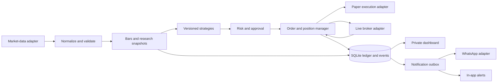

# SignalDesk: requirements and technical design

Version: 0.2 · 14 November 2026 · Owner: Mukul Gupta

Status: implementation baseline for a new standalone local repository. The owner has agreed that approval of a live trade plan may cover its defined protective exits and trailing updates. This does not approve any specific real order, unrestricted automated entries, or live-mode activation.

## 1. Product objective and agreed scope

Build a private trading assistant that finds cash-equity swing setups, explains their evidence and risk, tests them against live data without money, and later supports controlled execution. The architecture must allow a different market-data supplier, broker and notification provider without rewriting strategies or the dashboard.

Confirmed requirements:

- Start with the owner's own Angel One account and private access.
- Start with cash-equity swing trading; F&O is a separate later project.
- First release includes paper trading and individually approved real orders. Paper is the default; real orders require the readiness gates in section 12.
- Target ₹0–₹1,000 per month in incremental operating costs, running locally first. Trading capital, brokerage, taxes and transaction costs are separate.
- Scan up to 500 stocks; show the strongest 50 and preserve up to five eligible candidates per completed snapshot for a month.
- Explain entry, initial stop-loss, TP1, TP2 and changes to a trailing stop.
- In-app alerts only in phase 1. WhatsApp is deferred.
- Real-capital planning ceiling: ₹50,000. Paper capital mirrors this amount. This is not a per-trade loss allowance or permission to invest the whole amount at once.
- Operate only during exchange market sessions. No always-on or overnight local monitor is assumed.
- Approving an immutable trade plan may authorise its specified protective placements, partial exits and trailing adjustments; new entries still require individual approval.
- Preserve a route to unattended algorithmic execution and, separately, a licensed multi-user offering.

Success means reproducible decisions, reliable risk controls and an honest record of outcomes. Profitability is an evaluation question, not an acceptance guarantee. No fixed monthly return or AI accuracy promise is part of the product.

## 2. New repository and implementation status

This repository is independent of the previous trading workspace. The earlier Python engine and hosted TypeScript scanner are reference implementations only; no application code, credentials, databases, order history or deployment identity is copied automatically.

The previous implementations had different strategy definitions, an immediate-fill paper broker and entry-only live adapters. Those limitations must not be inherited silently. Build a single Python-owned risk/execution domain and a React interface against its API. Port chosen strategy formulas only after adding comparison fixtures and recording a strategy version.

Current contents: this specification, a decision record, implementation backlog, proposed configuration and an empty credential template. A broker connection, trading engine, AI integration and dashboard are not implemented in this new repository yet.

## 3. User experience

The private home screen shows mode, connected account alias, source freshness, connection/session health, next scheduled snapshot and any reconciliation problem.

Primary views:

1. **Market and scanner:** daily index changes with dates, sector alignment, top 50 candidates, READY/WATCH/AVOID states, source provenance and missing-data notices. Bearish signals are exit/avoid research in the initial long-only cash product.
2. **Trade plan:** entry condition and validity, stop, TP1/TP2, quantities, estimated fees, cash required, planned risk in rupees and percent, reasons, contradictions and evidence limitations.
3. **Paper account:** simulated cash, orders, fills, open risk, positions and a separate performance journal.
4. **Live account:** broker-confirmed balances, holdings, orders and positions. A distinct preview/confirm interaction is mandatory for each new live trade plan.
5. **Journal:** original snapshots and full trade lifecycle, including rejected, unfilled, expired, stopped and losing trades. Never replace the original plan with hindsight.
6. **Settings/health:** provider selection, masked connection status, risk limits, notification preferences, session renewal and pause controls.

User flow: connect own account → inspect plan → paper trade or preview a real plan → approve the exact real plan → monitor fills and broker-confirmed protection → review outcome. No broker login for hypothetical future visitors is built now.

## 4. Functional requirements

### FR-01: account connection

Use supported broker authentication, with interactive owner login at the start of a required session. Store session tokens server-side and expose only status to the UI. Do not promise permanent authentication. SmartAPI documents daily session expiry; refresh/reconnect behavior must be verified against the account and current API. Authentication failure blocks new live entries and raises a health event. [SmartAPI documentation](https://smartapi.angelone.in/docs)

Unattended daily login is a later optional capability, dependent on supported broker behavior and explicit approval to store any additional authentication secret. The pilot does not require storing a TOTP seed.

### FR-02: market data

Use Angel One as the first private live-data adapter. Maintain daily history for the full available universe, while initially streaming only 20–50 selected instruments plus all open positions and required indices. Expand subscriptions after measuring quotas and stability. A 500-stock research universe does not require storing all raw ticks indefinitely.

Normalize timestamps, instrument identifiers, prices, cumulative versus incremental volume, sessions and source metadata. Record both exchange-event and receipt timestamps. Detect stale, duplicate, out-of-order and missing updates. Reconnect with backoff, resubscribe, then backfill missing bars where supported. A recovered socket alone does not prove data continuity.

Quotes and candles must carry provider, source timestamp, trading session, timeframe, adjustment convention and quality flags. Do not blend providers silently during a running strategy. Unsupported depth or volume fields remain unavailable, not zero. Buying-pressure, CMF and order-book imbalance are explicitly labelled estimates, not investor identity or verified institutional fund flows.

### FR-03: scans and scheduling

Use the exchange calendar and Asia/Kolkata scheduling; store timestamps in UTC. Weekday cron alone is insufficient for holidays and special sessions.

- At the first regular-session startup: authenticate, reconcile and prepare research from completed prior-session candles. The previous 09:00 job is not enabled in this market-hours-only baseline; pre-open prices are not regular-session fills.
- 12:00 and 15:00: save research/status snapshots and update available live confirmation and filings. Daily strategies continue using completed daily bars.
- At the next regular-session startup: backfill the last completed session and evaluate closing setups. No 16:15/background overnight job is required. If finalized daily data is not available, show the actual cutoff and block affected decisions.
- Between snapshots: process live entry conditions and open-position monitoring continuously while the service is running. Three scheduled scans are not a trailing-stop engine.

Session boundaries and special sessions come from the exchange calendar. At shutdown, persist state and reconcile open positions/protection. Swing holdings may remain overnight: shutdown is not an instruction to liquidate. Broker-held protection and its validity must be verified before live enablement. Local trailing stops cannot move while the machine is off; overnight gaps remain possible. Apply newly available completed-bar trailing calculations after reconciliation at the next startup, using only the approved policy.

Jobs must have persisted progress, idempotent slot keys and a single active owner. Publish only complete runs passing a documented coverage rule; retain previous complete results on failure. Display the actual eligible-universe count and missing instruments, not a fictional 500/500. Store up to five eligible candidates; never pad with blocked trades.

### FR-04: signals and evidence

Every plan gets a stable ID and frozen strategy version, parameters, source data cutoff, universe version and reason set. Separate ranking score, historical outcome frequency and any calibrated probability. Hide probability when evidence is inadequate; always distinguish unresolved outcomes. AI is an optional evidence reviewer, disabled in the initial cost-controlled configuration until a model and budget are configured. It may explain contradictions and propose review candidates; deterministic risk gates control sizing and submission. Skills and an AI subscription do not by themselves provide a licensed live market feed or a running model integration.

Institutional evidence must distinguish:
- FII/FPI and DII aggregate cash-market trading totals: market context, not a live list of specific stocks bought by named funds. Store the reporting period, publication timestamp and provisional/final status. [NSE flow reports](https://www.nseindia.com/reports/fii-dii)
- Company shareholding disclosures: dated ownership snapshots, not current intraday purchases. [NSE shareholding filings](https://www.nseindia.com/companies-listing/corporate-filings-shareholding-pattern)
- Bulk/block-deal disclosures: specific disclosed transactions, not a complete investor ledger.
- Price/volume/depth indicators: pressure estimates, never labelled verified FII accumulation.

No claim is made that these feeds are already connected. A source adapter must demonstrate access and provenance first. Missing evidence cannot be fabricated by the model. Return forecasts must be labelled conditional estimates with horizon, costs, sample size and uncertainty; targets are plan levels, not promised profit. Compare any AI-assisted selection against a deterministic baseline on held-out data before claiming improvement.

Historical evaluations must use only information available at their timestamp. Today's filings, constituent lists and revised corporate-action data cannot be silently inserted into old evaluations. Initial paper results are prospective and are not retroactively manufactured from current winners.

### FR-05: realistic paper trading

Simulate orders against market observations received after plan publication and order submission. A touched limit is not automatically a guaranteed full fill. Define spread/slippage, delayed data, price gaps, partial-fill/volume-participation assumptions and cancellation expiry. When only daily bars are available, label execution precision as limited and resolve ambiguous target/stop sequences conservatively.

Maintain a cash ledger, fee model, open exposure and separate fills. Include brokerage, exchange/statutory charges, taxes and relevant delivery charges as configurable estimates, reconciled against actual broker charges before live evaluation. Apply splits/bonuses and other material corporate actions to holdings, plans and performance consistently. Never use adjusted historical prices as executable current prices.

### FR-06: TP1, TP2 and trailing-stop semantics

The following are proposed paper-test defaults, not agreed investment parameters:

- Long cash trades only. Define initial R per share from the permitted entry and initial stop; after a fill, freeze actual-entry R and recheck risk for the remaining quantity.
- TP1 at 1R and TP2 at 2R. Sell 50% of filled quantity at TP1, rounded down to a valid lot; the remainder exits at TP2 or the stop. With a one-share position, TP1 is a milestone only and the single share remains for TP2/stop.
- Start trailing the remaining position after TP1's confirmed fill, not merely after its price is touched. For a one-share position, activation at the TP1 milestone must be explicitly configured and labelled.
- Initial trailing candidate: highest completed daily-bar high since activation minus 2 × daily ATR(14). New desired stop is the greater of the old stop and this candidate, rounded to a valid protective tick. Never loosen a long stop. Intraday bar-based trailing is a separate selectable policy to evaluate later.
- Monitor price continuously even though this default trailing level changes on completed daily bars. A level reached during a gap is not a guaranteed fill at that level. If a new calculated stop is already crossed, enter the documented exit workflow rather than submitting an invalid stop modification.
- Keep `desired_stop`, `submitted_stop` and `broker_confirmed_stop` separate. Only an acknowledged modification earns a “stop updated” alert. On rejection, retain the previous confirmed protection and escalate.

The complete plan approval must disclose whether follow-up protective placements, partial exits and trailing modifications are automatic. Agreed live interaction: approve entry plus the explicitly displayed bounded exit policy once, then automate only its disclosed protection/exit actions. Any increased quantity, looser stop, new strategy or changed risk requires a new approval.

Do not assume broker-independent bracket/OCO behavior. The adapter must establish valid delivery-sale authorization, supported stop order types, validity across overnight holdings and sibling-order cancellation. Concurrent target/stop fills must never create an unintended short position. Where the required protection cannot be maintained safely, block the live API path for that capability.

### FR-07: risk controls and approval

All entry paths, including future automation, pass the same deterministic risk service. It checks available cash, reserved cash for pending orders, position size, aggregate open risk, daily realized plus unrealized losses, concentration, liquidity, spread, stale data, pending reconciliation and duplicate plans.

Confirmed capital basis: ₹50,000. Proposed simulation settings, not yet approved live risk limits: 0.5% initial risk per trade (₹250 at starting equity); 20% maximum position value (₹10,000); four positions; 2% aggregate initial open risk (₹1,000); 1.5% daily equity-loss entry lock (₹750). Recalculate monetary limits against the defined current account equity and reserved exposure. These are testing defaults, not claims that losses are capped at those levels. Fees, overnight gaps and slippage can exceed planned risk.

Approval is tied to an immutable plan revision, account, mode, quantities, price bounds and expiry. Revalidate at submission; material changes invalidate approval. No signal, WhatsApp response or page refresh implicitly authorises an order.

### FR-08: execution and recovery

Implement explicit order states: DRAFT → AWAITING_APPROVAL → RISK_CHECKED → SUBMITTING → ACKNOWLEDGED → PARTIALLY_FILLED/FILLED, with REJECTED, CANCEL_PENDING, CANCELLED, EXPIRED and UNKNOWN branches. Broker acknowledgement is not a fill.

Persist the intent and stable client-order key before network submission. On a timeout, query/reconcile before retrying; never blindly resend a potentially accepted entry. Broker idempotency support is a capability, not an assumption. Persist each fill independently. Size protection from actual filled quantity; update it when fills or partial exits change exposure.

On startup and reconnect, reconcile broker balances, open orders, fills and positions before allowing new entries. Detect manual activity in the broker app; surface differences and stop conflicting automation. Existing unsupported broker-app trades are tracked or flagged, not automatically adopted into a strategy.

If protection cannot be placed, enter a visible unprotected-position incident, block new entries, notify the owner and execute only the previously approved emergency policy. No default “guaranteed market exit”: permitted order types and price bounds must be checked with the broker.

### FR-09: pause and stop controls

Provide separate controls for pausing new entries, cancelling pending entries, and requesting closure of positions. Pausing does not cancel valid protective orders. Closing positions is a distinct, confirmed action and reports partial/rejected execution. Risk locks continue to allow necessary protective operations, subject to broker rules.

### FR-10: WhatsApp and other notifications

Provide a notification adapter and persistent outbox. In-app alerts and a searchable journal are mandatory. WhatsApp is explicitly outside phase 1. A later official WhatsApp Business Platform/approved-provider adapter depends on setup, template eligibility and a separate budget decision. No WhatsApp Web scraping or personal-session automation.

WhatsApp requires recipient permission and approved templates for business-initiated messages outside the service window. Pricing depends on message category and destination; do not assume trade alerts are approved utility messages or free. Verify this use case before making WhatsApp a release dependency. [Messaging policy](https://business.whatsapp.com/policy) · [Pricing](https://business.whatsapp.com/products/platform-pricing)

Events: setup ready, entry pending, partial/full fill, protection confirmed/rejected, TP1/TP2 fill, trailing stop confirmed, stop fill, exit, session expiry and persistent data outage. Every alert includes PAPER/LIVE, plan ID, event time, source freshness and relevant quantities. Setup alerts distinguish planned levels from actual orders/fills.

Example, illustrative values only:

```text
PAPER | plan P-104 | ENTRY FILLED | 10:20 IST
EXAMPLE NSE EQ | 10 shares @ ₹100.00
Initial SL ₹95.00 | TP1 ₹105.00: 5 shares | TP2 ₹110.00: 5 shares
Current SL ₹95.00 | Protection: SIMULATED
Planned initial price risk ₹50, plus estimated costs
```

Trailing example: `LIVE | P-104 | SL confirmed ₹95 → ₹101 | remaining 5 shares | broker acknowledgement time`. A pending or rejected amendment must say so instead.

Deduplicate by event ID, recipient and channel; use bounded retries, expiry and delivery receipts. Suppress obsolete trailing updates after a later revision or final exit. Prioritize protection failures over routine summaries. Avoid per-tick messages; cap routine messages and show cost estimates. A messaging outage must never prevent stop management. WhatsApp is an alert channel, not an order-control channel in release one.

## 5. Architecture: inexpensive now, replaceable later

Start with one Python backend containing clear modules, SQLite in WAL mode and a local React interface. Reuse the existing dashboard components through a local API; its current D1 routes require adaptation and are not automatically connected to the Python engine. Serve UI/API on the same local origin, or use a development proxy. Do not expose a laptop service directly to the public internet.



One process may run feed, scheduling, execution and notification loops initially, but database transactions must be short and external calls must not block protection monitoring. Use one execution owner per account and a bounded work queue. Browser closure has no effect while the backend is running. Laptop sleep, power loss and internet loss stop local processing; the app must not claim otherwise.

Do not add Kubernetes, Kafka, separate microservices, paid AI, a vector database, billing or a multi-user account system to the pilot. Use the existing Docker configuration only after changing its current Yahoo daemon path to the verified private-data workflow.

### Adapter contracts

- **MarketDataProvider:** capabilities, instruments, historical bars, snapshots, subscribe/unsubscribe, health, authentication status. Capabilities include supported exchanges, fields, timestamps, quotas and usage entitlement.
- **ExecutionBroker:** capabilities, account/funds, positions, order/fill queries, submit, cancel, modify and order-update subscription. No strategy sees broker tokens or raw order payloads.
- **NotificationProvider:** eligibility, send, delivery status and error classification. Template identifiers remain provider configuration.
- **Repository:** transactions, immutable plans/events, positions, jobs, outbox and ownership locks. SQLite implementation first, PostgreSQL later.

Normalized records include stable instrument ID, venue, segment, currency, tick/lot size, provider mappings and validity dates. Future derivative fields include expiry, strike, option type and contract multiplier; their presence does not enable F&O trading. Use decimal or integer minor-unit amounts for ledger/order calculations. Never infer identity from display symbol alone.

Core record families: instruments/mappings, bars, data-quality incidents, strategy versions, scan runs, snapshot candidates, trade plans/revisions, approvals, order intents, broker orders, fills, positions, cash/fee ledger, stop revisions, risk decisions, account reconciliations, scheduled jobs and notification outbox/delivery events. Every private trading record carries account ID and PAPER/LIVE mode, even with one owner.

Provider switching requires configuration plus a validated mapping/backfill, timestamp/adjustment checks and comparison run. Open positions remain associated with their original execution account. Changing the data source must not migrate or duplicate real positions. An NSE commercial feed may need a different transport or licensed vendor gateway; it is not assumed to be a free drop-in REST API.

## 6. Retention, security and operating behavior

- Show 30 days of top-five history. Proposed private audit retention is at least 12 months for plans, orders, fills and performance; confirm this choice before changing the current 30-day snapshot deletion behavior. Future commercial retention is reviewed separately.
- Avoid permanent full-market tick storage. Proposed raw-data retention is a rolling 1–7 days for the watched instruments, with selected incident samples and derived bars retained longer, subject to provider terms and a disk cap.
- Keep secrets out of browser bundles, source control, URLs generated by us and logs. Use OS keychain/encrypted storage for persisted sessions; ignored owner-readable environment files only for local configuration. Existing root `.env` is loaded by Docker; the hosted Site does not automatically read it.
- Bind locally by default. Even local write endpoints require an application session, origin validation and CSRF protection; loopback alone is not authorisation to trade. Any later network-accessible installation additionally needs HTTPS, strong owner authentication and account authorisation. Redact logs in both modes. Live and paper modes have separate configuration and visible identifiers.
- Use daily consistent database backups, verify restore before live enablement, and recover trading state from broker reconciliation after a restore. Backup credentials separately and securely.
- Track clock drift, feed age, data gaps, queue lag, unknown orders, unprotected quantities, last reconciliation, free disk and notification failures.
- Provisional liquid-watchlist quality goals: detect missing expected feed/heartbeat within 30 seconds; block fresh entries on required quotes older than 15 seconds; process eligible local signal events within 5 seconds at the 95th percentile under the pilot load. These are test targets, not broker/network guarantees. Market closure and legitimately inactive instruments need separate freshness handling.
- Daily startup: authenticate, load calendar/mappings, reconcile, verify data continuity and protection, then enable paper or approved-live entry flow. No automatic live re-arm after a crash or failed reconciliation.

## 7. Evaluation and trust

Keep signal quality and execution reliability separate. Report net return, realized/unrealized P&L, equity drawdown, profit factor, expectancy in R, exposure, turnover, fees/slippage, fill rate and unresolved trades. Show denominators and evaluation dates. Compare with an appropriate benchmark and the same deployed strategy version. Repeated appearances of the same setup in three daily snapshots do not count as three independent trades.

Use held-out/walk-forward periods and multiple market regimes; avoid tuning on the same sample used for claims. Proposed observation target: at least 8–12 weeks and 30 closed, distinct paper trades, extending the window when there are too few setups. This is a practical review checkpoint, not statistical proof or automatic permission for real capital. Small supervised live tests additionally evaluate real fill/cost differences.

## 8. Low-cost deployment and expense controls

Confirmed cap: ₹0–₹1,000/month, local first. These are budget allocations, not vendor quotations or promises of availability.

- Use the existing computer, local database and local dashboard: target ₹0 incremental server rent. Electricity, connectivity and backup storage still have costs.
- Use no paid AI initially. Allow small optional spending only after measuring its benefit.
- Leave WhatsApp disabled until its approved message rate and any provider fee fit the cap. Allocate ₹0 to WhatsApp in phase 1; use in-app alerts.
- Keep the remaining budget available for data access, fixed-IP connectivity or backup costs after obtaining actual quotes. If combined costs exceed ₹1,000, reduce scope or remain paper-only; do not assume all capabilities are free.
- Show a monthly cost worksheet: hosting + connectivity/static IP + data + messaging + storage/backup + optional AI. Trading charges and taxes are tracked separately in performance.

Angel One's published API-execution rules include registered static-IP requirements and constraints on algorithmic order types. An approval button in our website does not remove these API requirements. Confirm account-specific eligibility and supported protective order behavior before real orders. A local computer with dynamic internet is not presumed eligible. [Angel One API execution update](https://www.angelone.in/news/market-updates/what-s-changing-in-angel-one-s-smartapi-access-from-april-1-2026)

If a suitable static IP and reliable operation do not fit the budget, release the full paper/research flow and enter real trades manually in the broker's own app, recording them as externally executed trades. The in-app real API feature remains visibly unavailable rather than bypassing the restriction. Local unattended trailing cannot run while the computer sleeps; only verified broker-held protection survives a local outage.

## 9. Phased delivery and exit criteria

**Milestone A — settle contracts and strategy parity.** Finalise open trading-policy choices, canonical calculations, provider capability checks and schema. Establish frozen comparison fixtures. No real orders.

**Milestone B — private live-data paper pilot.** Connect Angel One, build bars, scan the universe, stream the small watchlist, implement realistic paper fills, TP1/TP2/trailing, journal, recovery and in-app alerts. WhatsApp is deferred; in-app alerts are sufficient for this milestone. Pass the paper and fault tests below.

**Milestone C — approved real orders in release one.** After static-IP/access requirements and protection tests pass, enable an owner-only preview/approve workflow for a small supervised allowlist and a separately agreed capital cap. Approval explicitly covers the exit policy. Without these prerequisites, leave this milestone gated and deliver B.

**Milestone D — private automated execution.** Later opt-in, following paper evaluation and supervised-live reconciliation. Require an explicit strategy/account/risk configuration, daily arming, order deduplication, protection supervision, incident alerts and a kill switch. No unrestricted “auto” toggle inherited from paper mode.

**Milestone E — commercial multi-user platform.** Separate project gate: appropriate data/display/derived-use agreements, applicable research/advice and execution requirements, tenant isolation, consent/account connections, quotas, support, billing and operational capacity. Move storage to PostgreSQL and introduce a durable worker queue when measured concurrency requires them. A shared research feed does not authorise trading through the owner's account for other users. [NSE data usage policy](https://www.nseindia.com/static/market-data/nse-data-policy)

**F&O remains deferred.** It requires contract/expiry management, lot sizes, margin, option-specific liquidity and risk, settlement rules, dedicated simulation and new approval gates. Cash-equity success alone is not evidence of an F&O edge.

## 10. Acceptance and fault tests

1. **Paper isolation:** paper mode never reaches a live placement endpoint, including after restart, retries or configuration errors.
2. **Freshness:** missing/stale data blocks new entries and is visible; reconnect repairs or flags gaps before resuming.
3. **Snapshots:** retrying a scheduled job cannot produce duplicate histories; a failed partial scan cannot replace a completed one.
4. **No look-ahead:** changing future bars/filings cannot alter a previously published plan. Same-bar fills are not fabricated.
5. **Partial fills:** entry and TP1 fills adjust cash, remaining quantity and protection exactly; small-lot behavior matches the documented policy.
6. **Trailing:** stops never loosen; repeated events do not resend the same modification; a rejected modification leaves the previous confirmed level visible.
7. **Uncertain submit:** crash/timeout after a broker accepts an order produces reconciliation, not a second entry.
8. **Target/stop race:** simultaneous exit events never sell more than the held quantity; unsupported atomic protection blocks live enablement.
9. **Session expiry/restart:** existing broker state is recovered before new entries; expired credentials cannot be mistaken for an empty account.
10. **Approval:** wrong account, stale plan, increased size and expired approval are rejected. Paper approval cannot authorise a real order.
11. **Risk and pause:** pending entries consume exposure budget; loss locks stop new entries while preserving protection; flattening is separately confirmed.
12. **Notifications:** outages, duplicate callbacks and out-of-order deliveries cannot affect execution; obsolete stop messages are suppressed and no secrets appear in alerts.
13. **Provider replacement:** recorded normalized inputs through two adapters produce equivalent strategy decisions within explicitly defined precision tolerances; unsupported fields are flagged.
14. **Budget/storage:** one full session of the 20–50 live-symbol pilot plus a 500-instrument daily scan remains within measured machine/API/disk limits; paid capabilities stay opt-in.
15. **Recovery:** restore a backup, reconcile current broker state and prove no duplicate order is emitted. Test internet loss, clock drift, disk-full and application shutdown.

## 11. Decisions and remaining checks

Confirmed: separate local Git repository; local-first ₹0–₹1,000 operating budget; ₹50,000 real-capital ceiling; paper plus individually approved real orders; plan approval includes its disclosed protective/partial-exit/trailing actions; market-session-only operation; in-app alerts only in phase 1.

Trading-rule response is interpreted as continuing evidence-led strategy design, not as explicit approval of numerical TP/trailing/risk settings. The proposed 1R/2R, 50/50 and daily ATR rules are paper-test hypotheses. They must be displayed in any live plan before that plan is approved.

Remaining checks:
- **O1 — loss limits:** confirm per-trade, daily-equity and aggregate-open-risk limits before live arming. Proposed paper limits are ₹250 / ₹750 / ₹1,000 at ₹50,000 equity.
- **O2 — execution connectivity:** verify account-specific API/static-IP eligibility and reliable connectivity during market hours within budget.
- **O3 — resolved:** approval covers only the displayed bounded exit policy, not new automated entries or increased risk.
- **O4 — strategy validation:** choose/version the initial strategy through tests; do not silently tune against observed results.
- **O5 — resolved:** no WhatsApp setup is required in phase 1.
- **O6 — overnight protection:** verify delivery-sale authorisation, broker-held stop persistence/expiry and behavior during application downtime. If unsupported, keep API live mode disabled.
- **O7 — retention:** proposed 12-month private audit retention and bounded raw data remain reviewable; shortlist display is 30 days.

## 12. Definition of ready for approved live use

Before enabling real API orders: O1/O2/O6 are resolved; authentication and static-IP eligibility are verified; execution/partial-fill/protection/restart tests pass; owner approves actual capital and per-plan risk; an independent broker-app recovery path is available; and the UI clearly separates real money from simulations. The initial real allowlist and quantities are explicitly limited. The new repository starts with `LIVE_TRADING_ENABLED=false`; the earlier project's credentials and runtime settings remain untouched.

Before unattended live use: additionally complete an outcome review, real fill/cost comparison, durable monitoring, incident procedures and explicit approval of automated entry behavior. Expensive infrastructure and future public distribution are not prerequisites for the private paper pilot.

